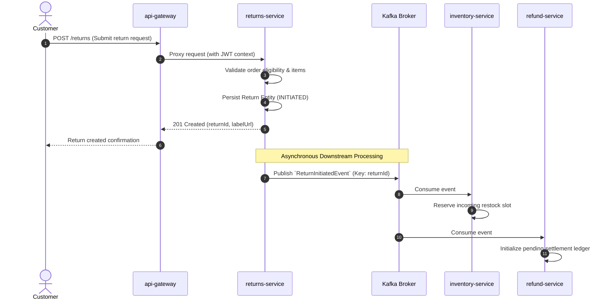

# Architecture Sequence Flow: [Flow Name]

* **Initiator**: [e.g., Customer Portal / Carrier Webhook]
* **Flow ID**: `SEQ-[Domain]-[Number]` (e.g., `SEQ-RET-001`)
* **Primary Path**: [Happy Path / Compensation Saga]

---

## 1. Sequence Diagram

---

## 2. Transaction Checkpoints & Outbox Events
* **Database State Checkpoint**: `returns` table updated to `INITIATED` inside atomic transaction with `outbox_events` table.
* **Failure Boundary**: If Kafka publishing fails, the transactional outbox polling worker retries every 500ms until successful acknowledgment.