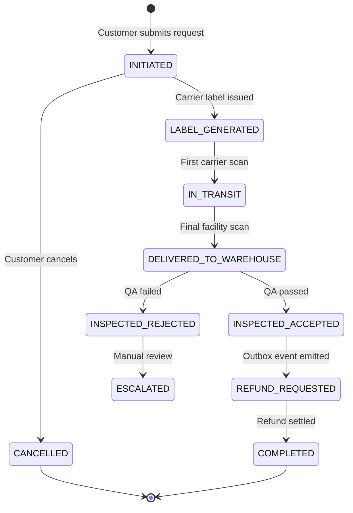

# State Machine Specification: [Domain Entity Name]

* **Scope**: [Global System | Microservice Local: e.g., returns-service]
* **Entity**: [e.g., ReturnOrder | RefundTransaction]
* **Primary Key / ID**: [e.g., return_id]

---

## 1. State Lifecycle Overview

---

## 2. State Definitions

| State Name | Description | Terminal? | Allowed Outgoing States |
| :--- | :--- | :--- | :--- |
| `INITIATED` | Return intent declared; awaiting shipment label. | No | `LABEL_GENERATED`, `CANCELLED` |
| `LABEL_GENERATED` | Shipping barcode assigned; awaiting carrier drop-off. | No | `IN_TRANSIT`, `CANCELLED`, `EXPIRED` |
| `IN_TRANSIT` | First transit scan confirmed by carrier gateway. | No | `DELIVERED_TO_WAREHOUSE`, `LOST_IN_TRANSIT` |
| `COMPLETED` | Settlement finalized and audit log emitted. | Yes | None |

---

## 3. Transition Rules & Invariants

### Transition: `INITIATED` -> `LABEL_GENERATED`
* **Triggering Event / Command**: `GenerateReturnLabelCommand`
* **Preconditions**:
    * Return item list contains at least 1 valid SKU.
    * Carrier rate quote successfully resolved.
* **Side Effects**:
    * Emits `ReturnLabelGeneratedEvent` to Kafka.
    * Saves label S3 URL to return database.

### Transition: `DELIVERED_TO_WAREHOUSE` -> `INSPECTED_REJECTED`
* **Triggering Event / Command**: `ItemInspectionFailedEvent`
* **Preconditions**: Reason code present (e.g., `DAMAGED_BY_USER`, `INCORRECT_ITEM`).
* **Side Effects**:
    * Emits `ReturnEscalatedEvent`.
    * Triggers notification to customer support portal.