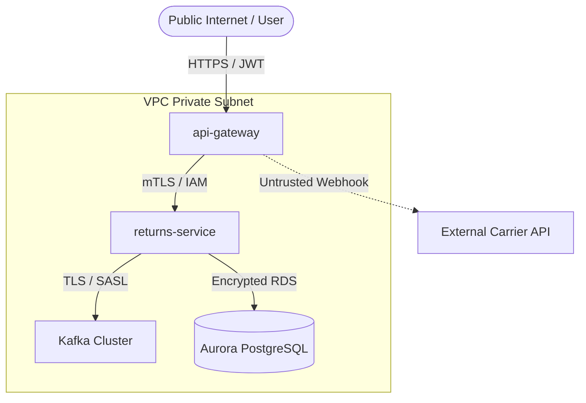

# Security Threat Model: [System / Component Name]

* **Date Conducted**: [YYYY-MM-DD]
* **Reviewers**: [AppSec Engineer, Lead Architect]
* **Methodology**: STRIDE (Spoofing, Tampering, Repudiation, Information Disclosure, Denial of Service, Elevation of Privilege)

---

## 1. Trust Boundaries & Data Flow Diagram

---

## 2. STRIDE Threat Analysis Matrix

| Threat ID | Category | Threat Description | Impact | Mitigating Control | Status |
| :--- | :--- | :--- | :--- | :--- | :--- |
| `SEC-01` | **Spoofing** | External actor posts fake carrier webhook updates. | High | Enforce HMAC-SHA256 signature verification on all carrier endpoints. | Mitigated |
| `SEC-02` | **Tampering** | Refund amount altered during in-transit HTTP call. | Critical | Enforce strict TLS 1.3 on all internal API calls; validate price against DB. | Mitigated |
| `SEC-03` | **Info Disclosure** | Customer PII (name, address) leaked into Kafka logs. | High | Strip or encrypt PII fields before serialization; mask payload in logs. | Mitigated |
| `SEC-04` | **DoS** | Bot spamming return generation endpoints. | High | WAF rate-limiting on `api-gateway` (max 10 req/min per user ID). | Implemented |